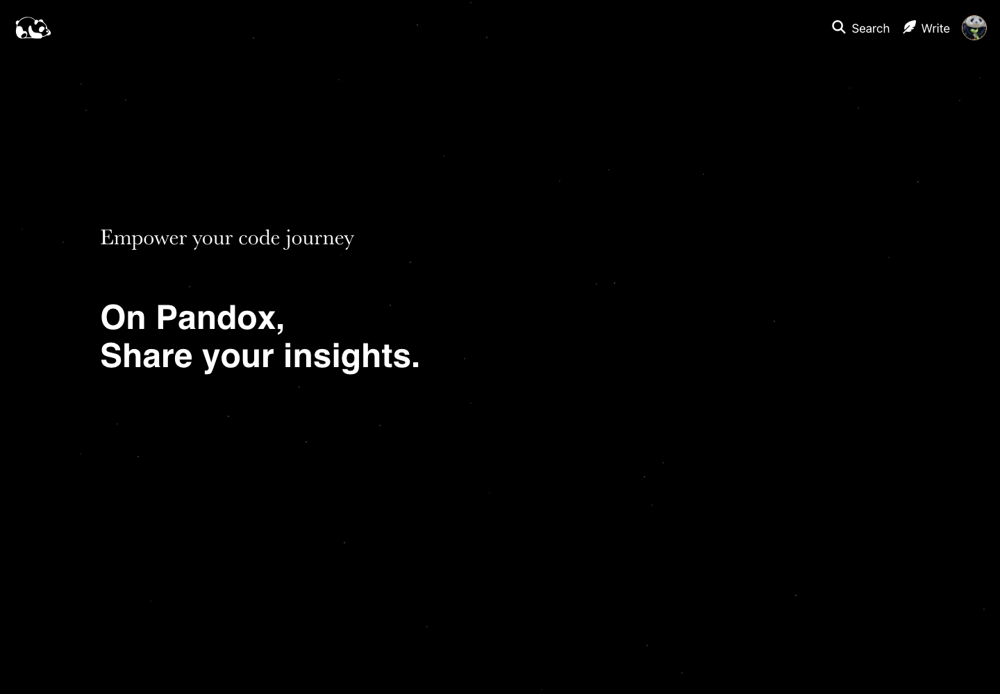
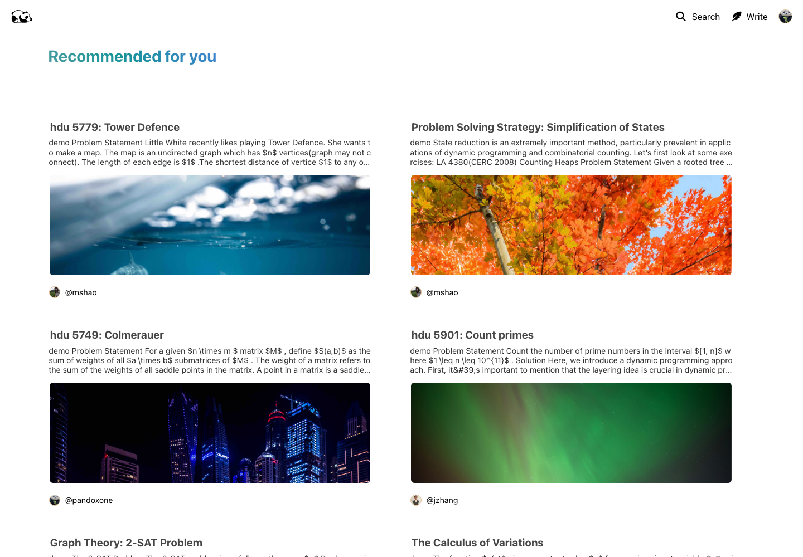
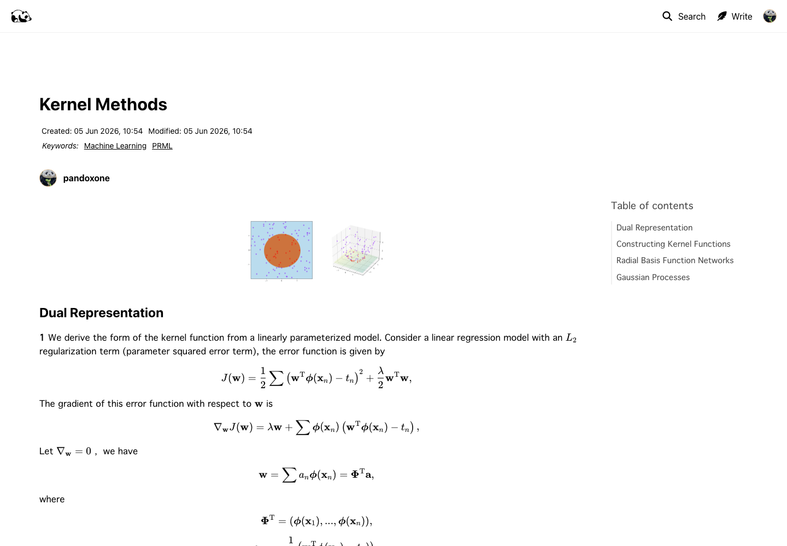
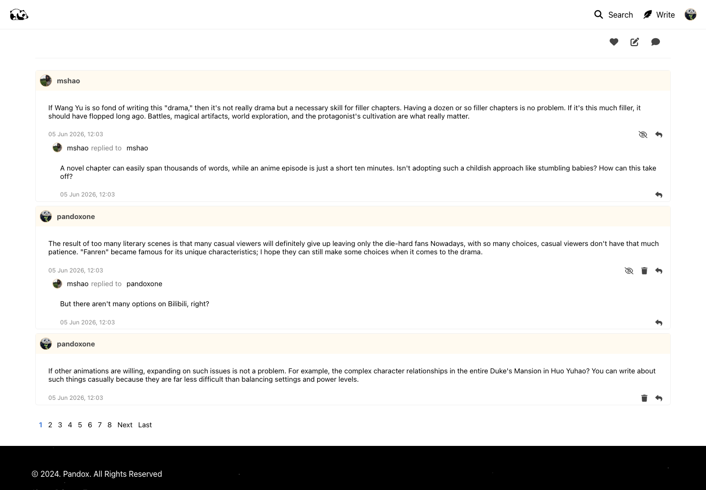
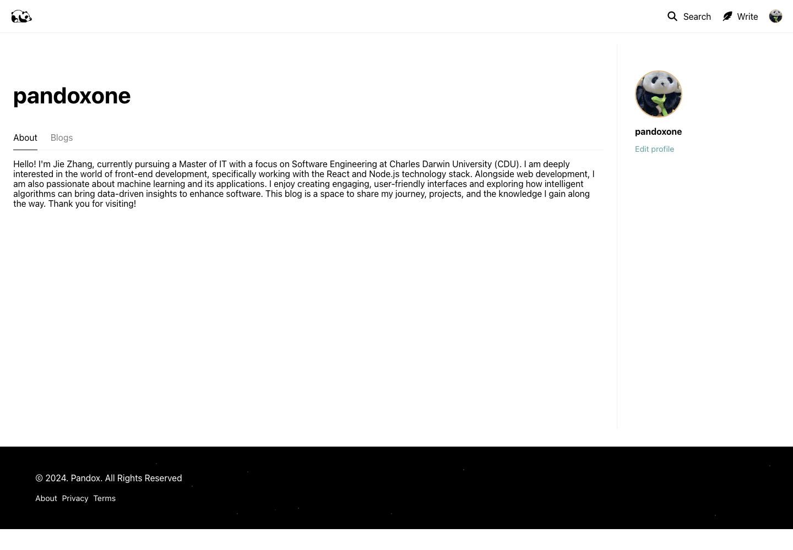
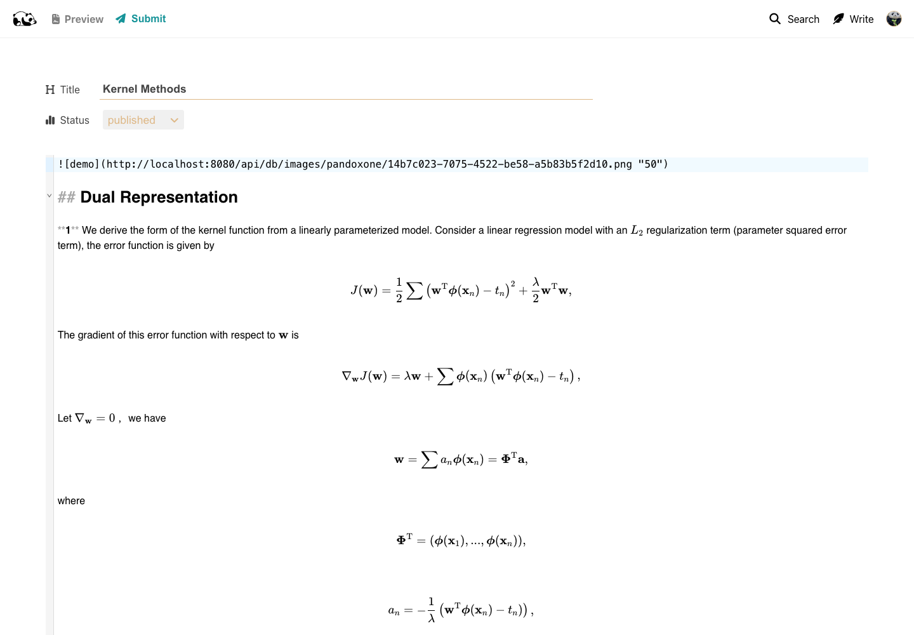

# Pandox Blog Platform Frontend

Frontend for Pandox, a full-stack technical blogging platform. It is a React/TypeScript single-page app where users can write Markdown articles, read technical posts, manage profiles, comment, like, follow other users, and search content.

## Project Summary

| Area | Summary |
| --- | --- |
| Product | Technical blogging platform for long-form programming and machine-learning notes |
| Frontend scope | React app with routes for home, profiles, article pages, editor, search, settings, login, and registration |
| Backend | Node/Express API with MySQL, Redis, image storage, and Elasticsearch search |
| Public frontend URL | `https://pandox-reactjs.vercel.app/` |
| Demo status | The Oracle VPS is offline. The public Vercel URL may load the frontend only, without live backend data. The screenshots below were captured from a local seeded setup with MySQL and Redis running. |

## Product Screenshots

| Landing view | Recommended feed |
| --- | --- |
|  |  |

| Article reader with math rendering | Threaded comments |
| --- | --- |
|  |  |

| User profile | Existing article in Markdown editor |
| --- | --- |
|  |  |

## Engineering Highlights

- Built a routed React app with pages for browsing posts, reading articles, editing articles, user profiles, search, settings, login, and registration.
- Added a Markdown editor with CodeMirror, preview mode, KaTeX formulas, syntax highlighting, tables, image rendering, and a generated table of contents.
- Organized backend calls into Axios service files with TypeScript response types.
- Used Redux and Redux Thunk to keep login state available across the app.
- Added logged-in author actions such as creating posts, editing posts, setting visibility, uploading images, and navigating from profile pages to articles.
- Connected the frontend to backend APIs for auth, users, pages, comments, images, likes, follows, and search.

## Skills Shown

| Skill | Evidence in this project |
| --- | --- |
| React app structure | Nested React Router routes, reusable components, and separate service files |
| Technical writing UI | Markdown editing, preview, KaTeX, code highlighting, images, and table of contents |
| API integration | Axios clients for auth, users, pages, comments, images, likes, follows, and search |
| User flows | A complete reader-author loop: publish, browse, read, comment, like, follow, and search |

## Tech Stack

| Layer | Tools |
| --- | --- |
| UI | React 18, TypeScript, React Router |
| State/API | Redux, Redux Thunk, Axios |
| Styling | styled-components, Sass, CSS |
| Editor/rendering | CodeMirror 6, Marked, KaTeX, highlight.js, Lezer Markdown |
| Backend integration | Express API, JWT auth, WebSocket endpoint |
| Data/search | MySQL, Redis, Elasticsearch |

## Run Locally

```bash
npm install
cp .env.example .env
npm run start:dev
```

Expected frontend `.env`:

```bash
REACT_APP_BASE_URL_DEV=http://localhost:8080
REACT_APP_BASE_URL_PROD=https://your-backend-domain.example.com
REACT_APP_WS_URL=ws://localhost:8080
```

Seeded login accounts:

| Username | Password |
| --- | --- |
| `pandoxone` | `1234` |
| `jzhang` | `1234` |
| `mshao` | `1234` |
